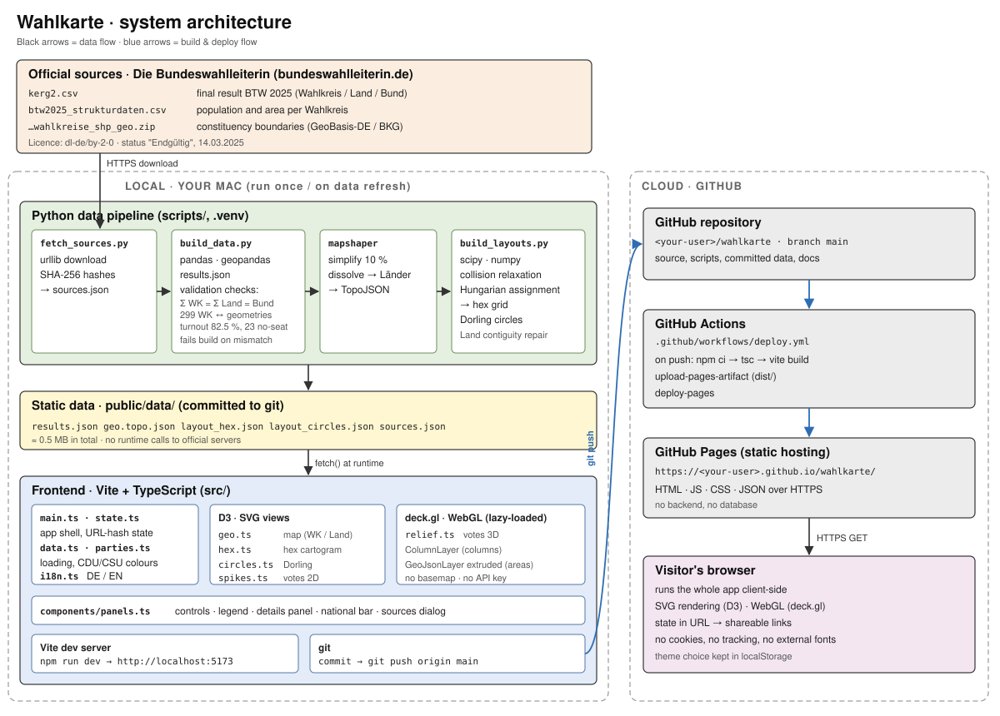

# Wahlkarte · Bundestagswahl 2025

Interactive maps of the 2025 German federal election (Bundestagswahl), based **only on the final official result** published by Die Bundeswahlleiterin.

| View | What it shows |
|---|---|
| **Karte / Map** | Accurate shapes coloured by the strongest party (Erst- or Zweitstimme), at Land, Wahlkreis or **Gemeinde** level (≈10,700 municipalities; large cities split by Wahlkreis, Berlin/Hamburg by Wahlkreis); colour lightness shows the margin |
| **Hexagone / Hexagons** | Tile map: Germany's outline is filled with exactly 299 equal hexagons, one per Wahlkreis. Wahlkreise have near-equal population, so area ≈ population. Länder are separated by white gaps; Land level colours each Land by its winner |
| **Kreise / Circles** | Dorling cartogram: circle area ∝ eligible voters (or valid votes), per Wahlkreis or per Land |
| **Stimmen 2D / Votes 2D** | Spike map in the style of population-density spike maps: tilted map, absolute votes of one party on a 5 km grid (≈14,000 spikes), or one spike per Wahlkreis / Land |
| **Stimmen 3D / Votes 3D** | Tiltable 3D relief (WebGL): the 5 km grid as ≈14,000 square columns in the same colour ramp and style as the 2D raster, or columns / extruded areas per Wahlkreis or Land; height = absolute votes |

Party selector: CDU/CSU (one choice; CDU drawn black/dark grey, CSU dark blue-grey in Bayern), AfD, SPD, GRÜNE, Die Linke, BSW (not in the Bundestag, 4.98 %), SSW.
The interface is German / English, every view state is stored in the URL (shareable links). The site opens in light mode; a dark mode can be switched on with the ◐ button.



## Data sources (official only)

Results come from **Die Bundeswahlleiterin** (Federal Returning Officer), Wiesbaden; boundaries from Die Bundeswahlleiterin and the BKG. `public/data/sources.json` records the exact URL, retrieval date and SHA-256 hash of every file. The website shows the same list under "Quellen & Methode".

| # | File | Content | Page |
|---|---|---|---|
| 1 | [`kerg2.csv`](https://www.bundeswahlleiterin.de/bundestagswahlen/2025/ergebnisse/opendata/btw25/csv/kerg2.csv) | Final result (status "Endgültig", 14.03.2025) for all Wahlkreise, Länder and the Bund: eligible voters, voters, valid and invalid votes, Erst- and Zweitstimmen per party, elected / not elected | [Open Data](https://www.bundeswahlleiterin.de/bundestagswahlen/2025/ergebnisse/opendata.html) |
| 2 | [`btw2025_strukturdaten.csv`](https://www.bundeswahlleiterin.de/dam/jcr/181f9e38-38db-4f64-991c-8141dfa0f2cb/btw2025_strukturdaten.csv) | Structural data per Wahlkreis (population, area) | [Open Data](https://www.bundeswahlleiterin.de/bundestagswahlen/2025/ergebnisse/opendata.html) |
| 3 | [`btw25_geometrie_wahlkreise_shp_geo.zip`](https://www.bundeswahlleiterin.de/dam/jcr/556bec9c-be80-4818-a368-fe6596f15f08/btw25_geometrie_wahlkreise_shp_geo.zip) | Generalised Wahlkreis boundaries (shapefile, WGS84). Land borders are derived by dissolving these shapes | [Wahlkreiseinteilung – Downloads](https://www.bundeswahlleiterin.de/bundestagswahlen/2025/wahlkreiseinteilung/downloads.html) |

| 4 | [`btw25_wbz.zip`](https://www.bundeswahlleiterin.de/dam/jcr/e79a7bd3-0607-4e87-9752-8e601e299e00/btw25_wbz.zip) | Wahlbezirksstatistik: results of all ~95,000 polling-station and postal districts, with municipality codes | [Weitere Ergebnisse](https://www.bundeswahlleiterin.de/bundestagswahlen/2025/ergebnisse/weitere-ergebnisse.html) |
| 5 | [`vg250_12-31.utm32s.shape.ebenen.zip`](https://daten.gdz.bkg.bund.de/produkte/vg/vg250_ebenen_1231/2024/vg250_12-31.utm32s.shape.ebenen.zip) | Bundesamt für Kartographie und Geodäsie (BKG): official municipality boundaries VG250, as of 31.12.2024 | [BKG](https://gdz.bkg.bund.de/index.php/default/verwaltungsgebiete-1-250-000-stand-31-12-vg250-31-12.html) |

Files 1–4 are from Die Bundeswahlleiterin, file 5 from the BKG (the federal mapping agency, also the basis of the official constituency boundaries).

Licence: Datenlizenz Deutschland – Namensnennung – Version 2.0 ([dl-de/by-2-0](https://www.govdata.de/dl-de/by-2-0)). © Die Bundeswahlleiterin, Wiesbaden 2025; geometric basis © GeoBasis-DE / BKG.

### Checks run on every data build (`scripts/build_data.py`)
The build stops if any of these fails:
- the result file is marked "Endgültig" (final);
- exactly 299 Wahlkreise and 16 Länder, and every Wahlkreis number has a geometry with the right Land;
- for every party and both votes: sum of Wahlkreise = sum of Länder = Bund;
- party votes add up to valid votes in every area, and voters = valid + invalid;
- eligible voters (60,510,631) and turnout (82.5 %) equal the official national figures;
- exactly 23 Wahlkreis winners without a seat (Zweitstimmendeckung), as officially reported.

Polling-district boundaries (Wahlbezirke) are not published for Germany as a whole, so the finest mapped level is the municipality (official BKG boundaries). Its results are the sum of all polling districts in it, with postal votes distributed as described below.

For the 5 km grid and the municipality map (`scripts/build_grid.py`), additionally:
- the polling-district file adds up to the official result in every Wahlkreis, for every party and both votes;
- every postal district is assigned to the polling-station districts it serves and distributed by their official count of postal-ballot holders (A2); jointly counted postal boards are matched via the official "Briefwahlzugehörigkeit" code;
- the grid preserves every party's national total.

No media, polling, Wikipedia or other third-party data is used.

## Run it locally

Requirements: Node.js ≥ 20, Python ≥ 3.11.

```bash
npm install
```

```bash
npm run dev
```

Then open http://localhost:5173. The processed data is already in `public/data/`, so Python is only needed to rebuild it.

### Rebuild the data from the official sources

```bash
python3 -m venv .venv && .venv/bin/pip install -r requirements.txt
```

```bash
npm run data
```

This runs `fetch_sources.py` (download, hashes), `build_data.py` (parse, checks, geometry, Land label points) with `mapshaper` (simplify, dissolve Länder → TopoJSON), `build_layouts.py` (hexagon tile map and Dorling circles) and `build_grid.py` (5 km vote grid for the dense spike map; `GRID_KM` sets the cell size).

The hexagon layout fills Germany's outline with 299 cells, assigns Wahlkreise to cells by optimal transport, then swaps neighbouring cells until every Land is compact and contiguous. `HEX_BLEND` (default 0.6) trades geographic accuracy (1) against even density (0). Manual tweaks go into `scripts/hex_overrides.json` as `{"<Wahlkreis-Nr>": [col, row]}`; the Wahlkreis is swapped with whoever holds that cell.

## Hosting on GitHub Pages

The site is fully static, so GitHub Pages can serve it for free:

1. Create a repository named `wahlkarte`. If you choose another name, change `base` in `vite.config.ts`.
2. Push this folder to `main`.
3. In the repository go to *Settings → Pages → Build and deployment → Source*, select **GitHub Actions**.
4. Every push to `main` runs `.github/workflows/deploy.yml`, which builds the site and publishes it to `https://<user>.github.io/wahlkarte/`.

GitHub Pages on a free account needs a **public** repository.

## Project structure

```
scripts/        Python data pipeline (fetch, build + checks, layouts)
public/data/    processed data served to the browser (committed)
src/            TypeScript app: main.ts, state.ts, data.ts, parties.ts, i18n.ts
src/views/      geo, hex, circles, spikes (D3/SVG), relief (deck.gl/WebGL, lazy-loaded)
src/components/ controls, legend, details panel, national bar, sources dialog
docs/           architecture diagram
```
